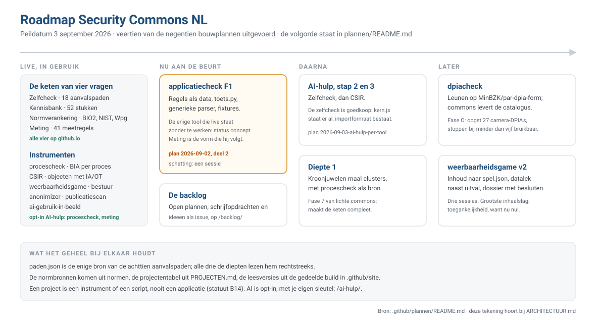

# Plannen

De bouwplannen achter de commons. Elk plan staat op de datum waarop het is geschreven, en blijft staan
nadat het is uitgevoerd: het legt vast waarom iets zo is gebouwd, niet alleen wat er staat.

Een plan is geen norm. Wat er nu geldt staat in [REDACTIESTATUUT.md](../REDACTIESTATUUT.md), wat er nu
is in [ARCHITECTUUR.md](../ARCHITECTUUR.md) en in de
[projectentabel](../PROJECTEN.md). Wijkt een plan daarvan af, dan heeft het plan het nakijken.

De tekening hierboven is de korte versie: wat er live staat, wat er nu wordt gebouwd, en wat
daarna komt. De tabel hieronder is de volledige stand, plan voor plan. Elk plan dat nog open staat
heeft een issue met het label `plan` in de repo waar het werk landt; alle open issues, de
schrijfopdrachten en de gaten uit de data staan bij elkaar op
[de backlog](https://security-commons-nl.github.io/backlog/).

| Plan | Waarover | Stand |
|---|---|---|
| [2026-08-28-aanvalspaden-keten.md](2026-08-28-aanvalspaden-keten.md) | De keten zelfcheck, risicoanalyse en meting rond een gedeelde `paden.json` | uitgevoerd |
| [2026-08-28-portfolio-review.md](2026-08-28-portfolio-review.md) | Doorlichting van alle repo's: wat leeft, wat overlapt, wat kan weg | uitgevoerd |
| [2026-08-29-voorpagina-en-werkplaats.md](2026-08-29-voorpagina-en-werkplaats.md) | De voorpagina gegenereerd uit de projectentabel, en de werkplaats eromheen | uitgevoerd |
| [2026-08-30-architectuur-en-backlog.md](2026-08-30-architectuur-en-backlog.md) | De architectuurplaat en een backlog die uit de data volgt in plaats van uit een bord | uitgevoerd |
| [2026-08-30-crosswalk.md](2026-08-30-crosswalk.md) | De normverankering: van barriere naar BIO 2.0, NIST CSF, Wpg en AVG | uitgevoerd |
| [2026-08-30-rationalisatie.md](2026-08-30-rationalisatie.md) | De security-shop opgegaan in de kennisbank, en de kennisbank als bron van het handelingsperspectief | uitgevoerd; de repo Handelingsperspectief is op 31-08-2026 door de eigenaar verwijderd |
| [2026-08-31-meten-voordat-je-ingrijpt-opsplitsen.md](2026-08-31-meten-voordat-je-ingrijpt-opsplitsen.md) | Het pijler-item van 33.000 tekens uit elkaar halen naar vier stukken met een kloppend etiket, `pijler` zichtbaar maken, en de SOC-cluster een keuzehulp geven | uitgevoerd |
| [2026-09-01-csir-keten.md](2026-09-01-csir-keten.md) | De CSIR Assessment Tool: objectclassificatie en control-register uit twee Excel-bestanden samengebracht tot één offline instrument met dossier, uitdraai en handreiking uit de kennisbank | uitgevoerd |
| [2026-09-02-elk-project-een-pagina.md](2026-09-02-elk-project-een-pagina.md) | B13 uitrollen: de tien projecten zonder pagina een leesversie geven, en de gedeelde site-build op één plek | uitgevoerd 03-09-2026 |
| [2026-09-02-applicatiecheck.md](2026-09-02-applicatiecheck.md) | Applicatiecheck: één gekochte applicatie tegen BIO2 uit configuratie-export en logsample; bewijsmodel A/B/C/D, regels als data, dossier per maatregel; eerste toepassing een zaaksysteem | F0 uitgevoerd; F1 t/m F4 open, issue [applicatiecheck#3](https://github.com/security-commons-nl/applicatiecheck/issues/3) |
| [2026-09-02-lichte-commons.md](2026-09-02-lichte-commons.md) | Geen applicaties meer: het criterium instrument-of-script, de vaste vorm, per repo een oordeel (grc-platform neemt afscheid) en de volgorde van ombouwen | fase 0 t/m 6 uitgevoerd; fase 7 (diepte 1) open, issue [aanvalspaden#6](https://github.com/security-commons-nl/aanvalspaden/issues/6) |
| [2026-09-02-normen.md](2026-09-02-normen.md) | Eén dataset-repo voor de normbronnen (BIO 2.0, NIST CSF 2.0, Wpg, AVG): één schema, een vingerafdruk, afnemers kopiëren met een `--check` | uitgevoerd |
| [2026-09-02-procescheck-instrument.md](2026-09-02-procescheck-instrument.md) | procescheck van applicatie naar instrument: zes BIA-vragen, rekenregels, dashboard en de blast radius (uit blast-radius) als één pagina met een JSON-dossier, kroonjuwelenlijst als uitdraai voor diepte 1; volledig uitgeschreven met tests | uitgevoerd 03-09-2026 |
| [2026-09-03-ai-hulp.md](2026-09-03-ai-hulp.md) | AI-hulp met eigen sleutel als patroon voor alle instrumenten: aparte pagina, voorstel in plaats van schrijven, Mistral standaard; eerste uitwerking in procescheck | uitgevoerd 03-09-2026 |
| [2026-09-03-meting.md](2026-09-03-meting.md) | Meting als instrument in aanvalspaden/meting/: 41 meetregels op exports en de Linux-dump van iamscan, bewijs per chokepoint, witte vlekken hardop; posture-tool en iamscan gaan erin op | uitgevoerd |
| [2026-09-03-ai-hulp-per-tool.md](2026-09-03-ai-hulp-per-tool.md) | Stap 8 van de AI-hulp: de kern gekopieerd en bewaakt, per tool een eigen opdrachtenset, en de grens per tool (meting zet exports om, de zelfcheck vult alleen lege vragen, CSIR stelt de classificatie voor) | stap 1 (meting) uitgevoerd; stap 2 en 3 open, issue [aanvalspaden#5](https://github.com/security-commons-nl/aanvalspaden/issues/5) |
| [2026-09-03-weerbaarheid-game-v2.md](2026-09-03-weerbaarheid-game-v2.md) | De weerbaarheidsgame moderniseren: inhoud uit de code naar spel.json, vier scenario's in plaats van een knop, vertrouwelijkheid naast beschikbaarheid, een dossier met uitdraai voor het college, en import uit procescheck en de zelfcheck | wacht op uitvoering, issue [weerbaarheid-game#2](https://github.com/security-commons-nl/weerbaarheid-game/issues/2) |
| [2026-09-03-ontvlechting-voorpagina-en-werkplaats.md](2026-09-03-ontvlechting-voorpagina-en-werkplaats.md) | Ontvlechting van voorpagina (github.io) en werkplaats (github.com): profiel-README afslanken tot 25 regels, projectenlijst naar PROJECTEN.md, statuut B9 en website vernieuwen | uitgevoerd 03-09-2026 |
| [2026-09-03-dpiacheck.md](2026-09-03-dpiacheck.md) | `dpiacheck`: de pre-scan en het Rijksmodel DPIA van Binnenlandse Zaken als bewaakte kopie, gevuld met een maatregelencatalogus uit uitgevoerde gemeentelijke DPIA's; elk voorstel draagt zijn herkomst, AI kiest uit de catalogus en verzint niets, standalone zonder afhankelijkheid van het Rijk; cameratoezicht eerst, terugbijdrage aan het Rijk als het werkt | vastgesteld, wacht op uitvoering; fase O als issue [.github#20](https://github.com/security-commons-nl/.github/issues/20) |
| [2026-09-25-bronnen.md](2026-09-25-bronnen.md) | Verwijzen naar wat anderen al hebben (B15): de vulling van het bronnenregister, met de openbare catalogi van IBD en CIP als werkmateriaal | opzet uitgevoerd; vulling open, issue [kennisbank#84](https://github.com/security-commons-nl/kennisbank/issues/84) |
| [2026-09-26-normwijzer.md](2026-09-26-normwijzer.md) | De normwijzer: per maatregel een adres met wat de norm vraagt, wat je eraan kunt doen en welk bewijs je dan hebt, en een zoekvak voor de omgekeerde vraag | in uitvoering, issue [normen#14](https://github.com/security-commons-nl/normen/issues/14) |
| [2026-09-28-ingang-en-vulling.md](2026-09-28-ingang-en-vulling.md) | De ingang en de vulling: zoekvak op de voorpagina, privacy vullen, de normwijzer op de voorpagina, een voordeur per rol, jaarritme, eerste honderd dagen, status en tweede herkomst | stap 1, 3 en 4 uitgevoerd 28-09-2026; stap 2 grotendeels uitgevoerd 12-10-2026 (kennisbank #58); stap 5 tot en met 8 open, issue [kennisbank#85](https://github.com/security-commons-nl/kennisbank/issues/85) |
| [2026-10-12-beleidsset-op-maat.md](2026-10-12-beleidsset-op-maat.md) | De beleidsset op maat: de set naar de 21 BIO 2.0-domeinen met een toets per maatregel, een profielschema waarmee varianten vergelijkbaar zijn, per stuk een maatwerkblok voor een AI-agent, selectie per profiel, een aanleverformulier en de uitvraag aan andere gemeenten | stap 1 en 2 uitgevoerd 12-10-2026 (kennisbank #60 en #64), stap 3 tot en met 6 op 14-10-2026 (kennisbank #75), stap 8 op 15-10-2026 (kennisbank #77); stap 7 doorlopend, issue [kennisbank#62](https://github.com/security-commons-nl/kennisbank/issues/62) |
| [2026-10-14-risicogestuurd-managementsysteem.md](2026-10-14-risicogestuurd-managementsysteem.md) | GRC voor security, privacy en continuïteit als één risicogestuurde PDCA-ronde: wat het is, een GRC-tool tegenover een register met afleiding, prioriteit en AI-guardrails; met model, verzonnen voorbeeld, plakbare prompts en registersjabloon onder `governance`; vooraf de inhoudswijzers op de domeinroot afgeleid in plaats van bijgehouden | pagina live 14-10-2026 (kennisbank #72); stap 10 tot en met 12 open, issue [kennisbank#86](https://github.com/security-commons-nl/kennisbank/issues/86) |
| [2026-10-15-ai-securitylijn.md](2026-10-15-ai-securitylijn.md) | De AI-securitylijn na het VNG-webinar van 15-10-2026: verwijzen naar VNG, IBD, TNO en CPB; zeven nieuwe stukken (Copilot-keuzes, adversarial AI, rode vlaggen, use-case-catalogus, annex 1.4, Cbw voor ingekochte AI, baten en lasten); stoplichtenkader en toets-agent van Amsterdam en Utrecht als gedeeld materiaal; en het lege kwadrant verdediging mét AI: agent-patronen, use-case-lijst, keuzeblad | vastgesteld 15-10-2026, wacht op uitvoering, issue [kennisbank#83](https://github.com/security-commons-nl/kennisbank/issues/83) |
| [2026-10-29-site-is-het-product.md](2026-10-29-site-is-het-product.md) | De site is het product, de werkplaats staat erachter: na feedback van twee externe consultants (losse bouwstenen, geen geheel) een blok C in het statuut (site als product, elk stuk in een route, instrument als stap, één gezicht, een lat voor instrumenten), de projectenlijst van de voorpagina naar een werkplaatspagina, vijf leesroutes, en de lat per instrument bij aanraking; het gedeelde dossier als later plan | vastgesteld 29-10-2026; stap 1 (statuut), 2 en 4 (voorpagina, werkplaats, routes) voorbereid als PR op 29-10-2026, issue [.github#49](https://github.com/security-commons-nl/.github/issues/49) |
